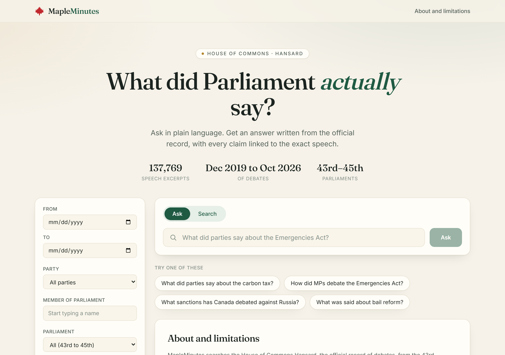
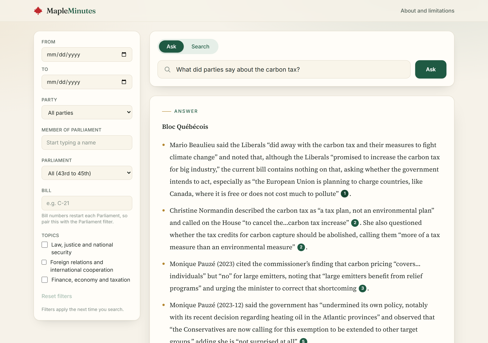
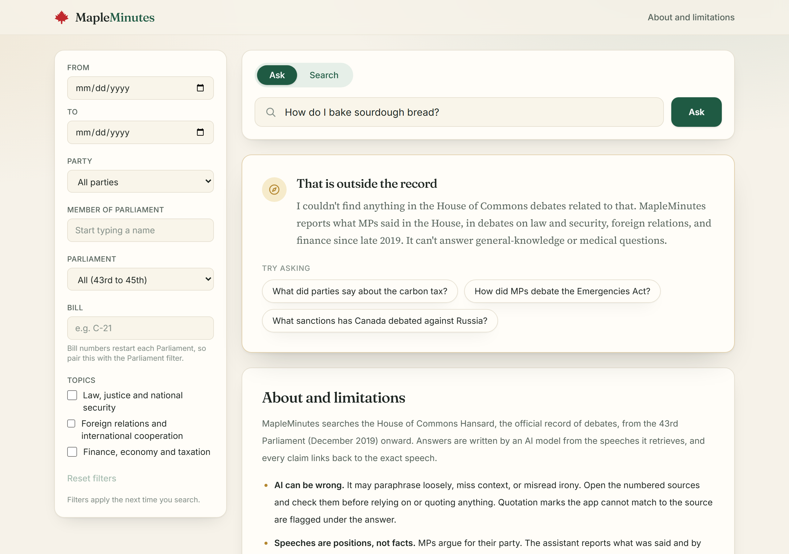
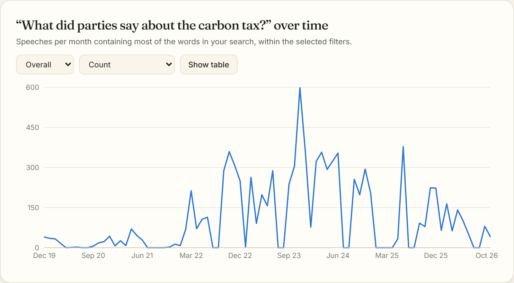
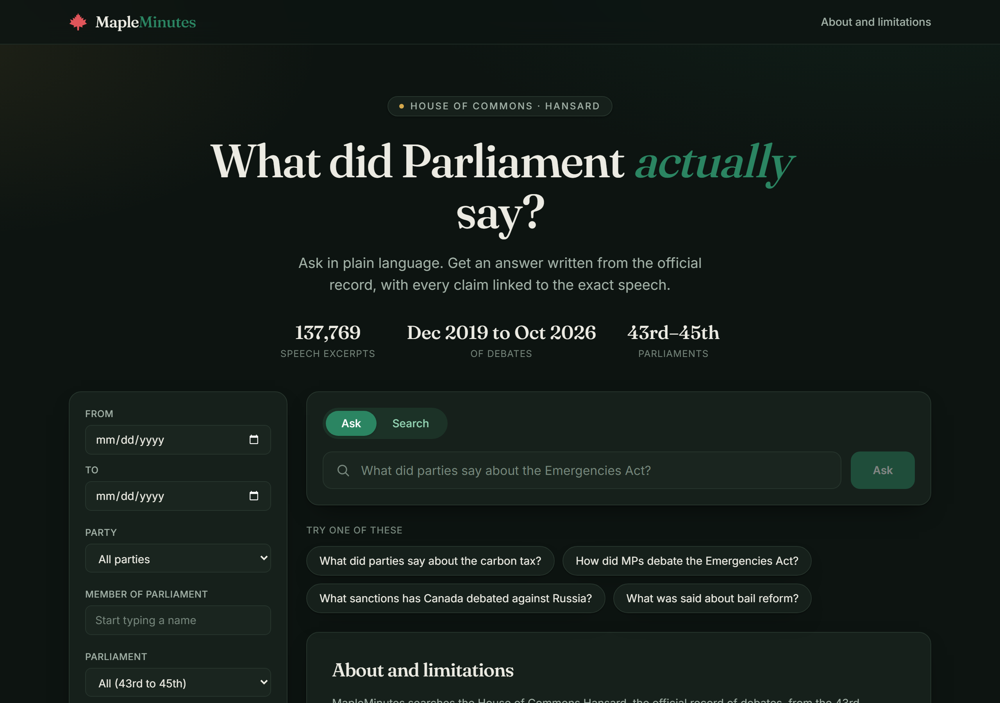
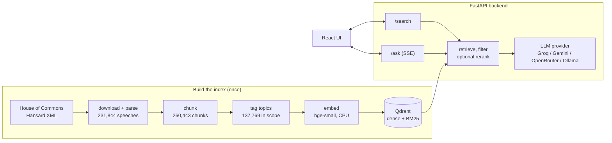

# MapleMinutes: Canadian Hansard Explorer

[](https://github.com/ishang14/maple-minutes/actions/workflows/ci.yml)

Ask questions about what Canada's MPs actually said in the House of Commons. MapleMinutes searches
the official Hansard (debates) from the 2019 federal election to today, writes an answer from the speeches it
finds, and links **every claim to the exact speech** in the official record.

It is free to run: no paid APIs, no GPU. Embeddings and search run on a laptop CPU, and the language model sits behind
a swappable interface (Groq, Gemini and OpenRouter free tiers, or a local Ollama model).

<p align="center">
  
</p>

## What it does

- **Ask** a question in plain language and get a streamed, cited answer. `[n]` markers are clickable and open the
  source speech (speaker, party, riding, date, full text, link to the official sitting).
- **Search** for a ranked list of matching speeches with highlighted matches.
- **Filter** by date range, party, MP (autocomplete), Parliament, bill number and topic.
- **See trends**: how often a topic comes up month by month, overall or split by party or topic.
- **Stay honest**: the assistant only uses the excerpts it is given, attributes statements to speakers and parties,
  stays neutral, and flags any quotation it cannot match word for word in the cited excerpt. Questions with no
  connection to the debates (recipes, trivia, medical definitions) get a clear "outside the record" reply with
  suggested rewrites instead of an invented answer.

| A cited answer | Outside the record |
|---|---|
|  |  |

| Trend over time | Dark mode and phone |
|---|---|
|  |  |

## How it works



1. **Parse.** Official Hansard XML to speech-level records (speaker, party, riding, heading, bill, text, link).
2. **Chunk.** One chunk per speech; speeches over about 400 tokens are split at sentence boundaries with overlap.
   Very short remarks (under 200 characters) are dropped.
3. **Tag.** Each chunk gets one or more of three topics (law and national security; foreign relations; finance,
   economy and taxation) from keyword rules on its debate heading and bill title. Chunks under procedural headings
   such as "Business of Supply" take the topic of their debate block. No model is run per chunk.
4. **Embed and index.** `BAAI/bge-small-en-v1.5` vectors plus BM25 sparse vectors in a local, on-disk Qdrant collection.
5. **Answer.** Embed the question, search with filters (dense, BM25 or both fused with RRF), optionally rerank, then
   stream an answer from the LLM that must cite excerpts as `[n]`. Afterwards the server checks the citations and
   every quoted phrase against the excerpts.

Before calling the LLM, a **relevance guard** checks how close the question is to anything in the whole index (cosine
similarity, ignoring filters). Below the floor (`MIN_RELEVANCE`, 0.65) the question is refused without an LLM call.
The floor was calibrated on the evaluation questions and off-topic probes (`python -m eval.calibrate_guard`): it
keeps every real search and refuses roughly half of unrelated ones. The prompt's scope rule handles the rest:
for a definition-style question ("What is epilepsy?") the assistant says it only reports debates, then summarises
what MPs said about it, naming speaker and party.

## Why not just ask an LLM?

Sending the question straight to a language model is the obvious alternative, so I measured it.
[`backend/eval/compare_plain_llm.py`](backend/eval/compare_plain_llm.py) asks the **same model** (Groq
`openai/gpt-oss-120b`) each question twice: plainly, as you would in any chat box, and through MapleMinutes. It then
searches the whole Hansard text this project holds for every quoted phrase of four or more words in either answer.
The full answers of the latest run are in [`docs/llm-vs-maple.md`](docs/llm-vs-maple.md).

Two debate questions, each run three times (model output varies from run to run):

| Question | Plain LLM: quoted phrases found in Hansard | MapleMinutes: quoted phrases found in Hansard | Links to the record |
|---|---|---|---|
| What did Conservatives say about the carbon tax in 2023? | 3 of 66 | 11 of 11 | none vs 8 per answer |
| What did Conservatives say about the Canadian Fuel Affordability Act? (debated September 2026, after the model's training data ends) | 1 of 19 | 15 of 15 | none vs 8 per answer |

- **The plain model sounds authoritative and cannot be checked.** For the 2023 question it wrote long answers full of
  quotation marks, attributed to named politicians, dates and "the House of Commons", and almost none of the
  quoted wording exists in Hansard. (Some phrases are credited to interviews or party platforms, which Hansard would
  not contain; the problem is that nothing lets you check any of them.) For the 2026 debate it also stated, wrongly, that
  the Act was introduced in early 2024; the only debate on it in the record is September 22, 2026.
- **MapleMinutes' quotes are real, and it shows its work.** Every quotation checked was word for word in the record,
  each answer links to the exact speeches, and quotes it cannot match are flagged.
- **It is not magic, and the comparison shows where it falls short.** Asked "What did Kelly DeRidder say about the
  Lawful Access Act in April 2026?", the plain model simply declined, while MapleMinutes without a filter honestly
  replied that the retrieved debates did not cover it, even though she spoke eight times in that debate: semantic
  search is weak at "what did this one person say". With the MP filter it finds her speeches (23 of 27 quoted phrases
  verbatim over two runs; the rest are small wording changes of the kind the quote check is built to flag). The
  answers also still sometimes refer to a named MP as "he" or "she", which the record does not support (see Limitations).

## Quick start

Requires Python 3.11+ and Node 20+. A built index is needed for search; see
[Rebuild the index](#rebuild-the-index) (the data is not stored in git).

```bash
# backend
cd backend
python -m venv .venv
.venv/Scripts/activate            # Windows; `source .venv/bin/activate` elsewhere
pip install -r requirements-dev.txt
cp ../.env.example .env           # then add a free LLM key, e.g. GROQ_API_KEY (see below)
uvicorn app.main:app --reload     # http://localhost:8000/health
pytest && ruff check .

# frontend (second terminal)
cd frontend
npm install
cp .env.example .env              # VITE_API_URL=http://localhost:8000
npm run dev                       # http://localhost:5173
npm test && npm run lint && npm run build
```

**LLM key.** Create a free key (for example at console.groq.com), put it in `backend/.env` as `GROQ_API_KEY=...`
and keep that file out of git (it is already ignored). Free-tier model names change; list what your key can use
with `GET https://api.groq.com/openai/v1/models` and set `GROQ_MODEL`. For an offline model, run Ollama and set
`LLM_PROVIDER=ollama`.

The first start takes about 30 seconds because the on-disk index is loaded into memory, and the first request
loads the embedding model. Only one process can use the local index at a time, so stop the API before re-indexing
or running the evaluation.

## Rebuild the index

All commands run from `backend/` with the virtualenv active. Every step is resumable.

| Step | Command | Output | Time on a laptop |
|---|---|---|---|
| 1. Download | `python -m pipeline.download` | `data/raw/*.xml` (709 sittings) | about 13 min (1 request/s) |
| 2. Parse | `python -m pipeline.parse` | `data/interim/speeches.parquet` | a minute or two |
| 3. Chunk | `python -m pipeline.chunk` | `data/processed/chunks.parquet` | about a minute |
| 4. Tag topics | `python -m pipeline.tag_domains` | `chunks_tagged.parquet`, `chunks_in_scope.parquet`, `domain_report.md` | a few minutes |
| 5. Embed | `python -m pipeline.embed` | `data/processed/embeddings/` (checkpoint every 4,096 chunks) | about 4 hours on a laptop CPU |
| 6. Index | `python -m pipeline.index` | `data/qdrant/` (911 MB) | about 6 min |
| Check | `python -m pipeline.index --query "carbon tax" --date-from 2023-01-01` | prints matching speeches | seconds |

Notes:
- **Sources.** The XML is fetched from
  `https://www.ourcommons.ca/Content/House/{parl}{sess}/Debates/{NNN}/HAN{NNN}-E.XML` (sittings are numbered per
  session from 001; a 404 ends a session). Set `CONTACT_EMAIL` so the downloader's User-Agent identifies you.
  The newest sitting may be an unrevised version; `python -m pipeline.download --refresh-last` re-fetches it.
- **Topics.** Edit `backend/pipeline/domains.yaml` (phrases per topic, procedural headings, block-scoring thresholds)
  and re-run step 4 onward. Re-running step 4 prints a report with 20 random headings per topic for spot-checking.
- **The embedding model is chosen once.** `data/processed/embeddings/meta.json` records the model, and the scripts
  refuse to continue if `EMBEDDING_MODEL` changes. A different model means re-embedding everything and recalibrating
  `MIN_RELEVANCE`.
- **Optional GPU.** Step 5 can run on a free Colab or Kaggle GPU with a larger model; copy the shards back and
  update `EMBEDDING_MODEL` and the vector size.

### Pipeline numbers (run on 2026-10-12)

| Stage | Result |
|---|---|
| Sittings | 709 files: 43-1 (44 sittings with speeches), 43-2 (124), 44-1 (389), 45-1 (148); 2019-12-05 to 2026-10-09 |
| Speeches | 231,844 (median 565 characters; about 12.5% have no party, mostly presiding officers) |
| Chunks | 260,443 (34,643 short speeches dropped); tokens per chunk: mean 196, p95 396, max 400 |
| In scope | 137,769 chunks (52.9%): law and security 16.9%, foreign relations 6.8%, finance and economy 33.1% (a chunk can have several topics) |
| Vectors | 137,769 x 384 dimensions, no chunk truncated (longest 434 of 512 WordPiece tokens) |
| Index | 911 MB on disk, dense and BM25 vectors plus full payloads |

## Configuration

Set in `backend/.env` (see [`.env.example`](.env.example) for every setting).

| Setting | Default | Purpose |
|---|---|---|
| `LLM_PROVIDER`, `LLM_FALLBACK_PROVIDER` | `groq`, none | `groq`, `gemini`, `openrouter` or `ollama`; the fallback is tried after a rate limit |
| `GROQ_API_KEY`, `GEMINI_API_KEY`, `OPENROUTER_API_KEY` | none | provider keys (never commit them) |
| `SEARCH_MODE` | `hybrid` | `dense`, `sparse` or `hybrid` retrieval |
| `RERANK_ENABLED`, `RERANK_MODEL` | `true`, MiniLM-L-6 | optional cross-encoder rerank |
| `RETRIEVE_CANDIDATES`, `RERANK_TOP_N` | 40, 8 | search depth, and excerpts sent to the LLM |
| `MIN_RELEVANCE` | `0.65` | relevance floor for the out-of-scope guard (0 turns it off) |
| `EMBEDDING_MODEL`, `QDRANT_PATH`, `COLLECTION_NAME` | bge-small, `./data/qdrant`, `hansard_v1` | index location and model |
| `ALLOWED_ORIGINS` | `http://localhost:5173` | CORS origins for the frontend |

**Choosing a search mode.** The evaluation below found the modes tied on recall. `dense` is much faster, so it is the
recommended setting for a deployment (`SEARCH_MODE=dense`, `RERANK_ENABLED=false`); the code default stays
`hybrid` for local experiments. `GET /health` reports the live setting. Measured on a laptop with the full index:
dense search takes about 0.5 s unfiltered and about 1.8 s with any filter (Qdrant's local mode ignores payload
indexes and scans payloads in Python; a Qdrant server with payload indexes would remove that cost); hybrid takes
about 3.9 s and hybrid with rerank about 6.1 s.

## API

| Endpoint | What it does |
|---|---|
| `GET /health` | `{"status": "ok", "index_loaded": true, "search_mode": "dense", "rerank": false}` |
| `POST /search` | `query`, optional `date_from`, `date_to`, `party`, `speaker`, `domains[]`, `parliament`, `bill`, `top_k`. Ranked chunks with metadata and an HTML-escaped snippet with `<mark>` matches |
| `POST /ask` | Same inputs. Server-sent events: `sources` (numbered excerpts), `token`\*, then `done` or `error` |
| `GET /filters` | parties, Parliaments, bills, date range, topics, corpus size |
| `GET /filters/speakers?q=` | MP name autocomplete |
| `GET /stats/trend` | monthly counts of chunks matching the query words, `group_by=none\|party\|domain`, plus monthly totals |

The `done` event carries `cited` (valid citation numbers), `invalid_citations`, `unverified_quotes` (quoted phrases
not found word for word in the cited excerpt), `out_of_scope` and `suggestions` (questions worth asking instead).
Citations are accepted as `[1]` or `【1】`, since some models use full-width brackets.

LLM providers live in `backend/app/llm/`. A rate limit is retried once, then the fallback provider is tried; if
everything fails the stream ends with a readable `error` event. The prompt (`backend/app/prompts.py`) requires
answers from the excerpts only, a `[n]` citation for every claim, attribution to speaker and party, quotes only if
word for word, neutral wording, and the sentence "The retrieved debates don't cover this." when the excerpts are
insufficient.

## Evaluation

`backend/eval/` holds 50 questions (18 law and security, 16 foreign relations, 16 finance; 14 from the 43rd
Parliament, 21 from the 44th, 15 from the 45th). Each lists its expected sources as metadata (heading, bill, speaker,
party, date range, optional phrases) and verbatim key phrases. `python -m eval.verify_questions` confirms every
expected source exists in the corpus. The set was frozen before any retrieval was run and was not edited after
seeing results. Heading, bill and speaker are not part of the indexed text, so they test whether search finds the
right debate from the question's meaning.

**Retrieval** (unfiltered, full index; recall@k = share of questions with a relevant chunk in the top k; with 50
questions one question is 2 percentage points):

| Configuration | recall@1 | recall@5 | recall@10 | MRR@10 | fact recall@8 | ms/query |
|---|---|---|---|---|---|---|
| vector only (dense) | 46% | 70% | 82% | 0.572 | 96% | 346 |
| keyword only (BM25) | 46% | 76% | 84% | 0.581 | 98% | 3,629 |
| hybrid (RRF) | 48% | 72% | 82% | 0.592 | 98% | 3,854 |
| hybrid + rerank | 42% | 76% | 84% | 0.557 | 98% | 6,100 |

This is the "debate" tier (a chunk from the expected debate). [`backend/eval/results.md`](backend/eval/results.md)
also has a stricter tier that requires a key phrase (recall 0 to 4 points lower, same ordering), precision@5, and
breakdowns by domain, Parliament and question type. "Fact recall@8" is the share of key phrases present in the 8
chunks the LLM sees.

- **The four configurations are statistically indistinguishable** at k = 5 to 10 on 50 questions. Do not read a
  ranking into 72% against 76%.
- **The small cross-encoder reranker did not help here** (lower recall@1 and MRR, about 2.2 s extra per query).
  A larger reranker such as `BAAI/bge-reranker-base` is untested.
- **Dense search alone is 10 to 18 times faster** for similar recall, which is why it is the recommended deployment mode.
- **Most misses are narrow gold labels, not failed searches.** Of the 8 questions where hybrid + rerank found no
  relevant chunk in the top 10, five returned the right topic from another date, heading or Parliament (the 44th
  Parliament's cybersecurity bill is reintroduced in the 45th, and the top results are exactly that bill); three look
  like real misses. The scores therefore understate quality.
- **Questions about one named person need the MP filter.** Without it, semantic search cannot tell speakers apart.

**Answer faithfulness** (12 questions spread across the set, answered by Groq `openai/gpt-oss-120b`; 2 hit the free-tier
rate limit, leaving 10 answers, measured with the current prompt):

- Every citation number was valid in 10 of 10 answers, and 57 of 64 sentences or bullets carried a citation.
- 86 of 92 quoted phrases appear word for word in the cited excerpt. Reading the other 6 against their sources, all 6 are
  genuine alterations ("unable" became "not being able", "would" became "will", "unequivocally" became
  "unquestionably"). The quote checker is built to catch exactly this.
- The checks cannot tell whether an excerpt truly supports a claim. A manual read of one answer found a subtler problem
  they miss: a phrase attributed to an MP who was citing UN experts. `backend/eval/faithfulness_sample.md` lists all 10
  answers beside their sources for a manual read; the verdict lines are blank.

**Relevance guard.** `python -m eval.calibrate_guard` scores the best match for 50 evaluation questions, 15 short
searches, 22 other debate topics and 26 off-topic probes. In-scope scores run 0.67 to 0.87 and off-topic 0.54 to 0.72;
they overlap slightly (a debated topic outside the three indexed areas, "residential schools", scores 0.668), so
similarity alone cannot separate them perfectly. The floor of 0.65 keeps every real search with a margin and refuses about
half of the off-topic probes; the prompt's scope rule handles the rest.

Limits: 50 questions is a small sample, the key-phrase tier favours keyword matching, and the faithfulness sample is 10
answers from one model.

## Data source and licence

Official House of Commons Hansard (English), downloaded from ourcommons.ca. The House's
["Important Notices"](https://www.ourcommons.ca/en/important-notices) say reproduction of House proceedings, in whole or
in part and in any medium, is permitted provided the reproduction is accurate and is not presented as official. The permission
does **not** extend to reproduction, distribution or use for commercial purpose of financial gain, and it says nothing
about automated access. This project is non-commercial, the downloader is polite (about 1 request per second, an
identifying User-Agent, no re-downloads), and answers are not official publications of the House.

Speaker metadata comes from the speaker string in the XML. Ministers appear without a riding, so riding (and sometimes
party) is borrowed from the same member's other speeches in the same Parliament and stays empty if the member never
appears with one. Presiding officers have a role and no party.

## Hansard XML at a glance

What the parser reads from each sitting file:

| Hansard element | Meaning |
|---|---|
| `ExtractedInformation/ExtractedItem[@Name=...]` | date (`MetaDateNum*`), `ParliamentNumber`, `SessionNumber`, `MetaNumberNumber` (sitting) |
| `OrderOfBusiness[@Rubric]` | section, such as `OralQuestionPeriod`, `StatementsByMembers` or `Other` (Government Orders) |
| `SubjectOfBusiness/SubjectOfBusinessTitle` | debate heading (falls back to `CatchLine`) |
| `Intervention[@Type]` | one speech: `Debate`, `Question`, `Answer`, `Interjection`, `Statement` and so on |
| `PersonSpeaking/Affiliation` | `Name (Riding, PARTY)` for private members; `Name (Role, PARTY)` for ministers and others |
| `Document[@Type="3"]` | bill reference (for example `C-31`) |

Each speech links to the human-readable sitting page
`https://www.ourcommons.ca/DocumentViewer/en/{parl}-{sess}/house/sitting-{n}/hansard#Int-{intervention id}`.

## Limitations

- **Coverage.** English only; House of Commons only (no Senate or committees); and only the three topics above, tagged
  automatically from headings and keywords, so some speeches are mislabelled or missing. Health, housing and immigration
  debates are mostly outside the index by design.
- **AI can be wrong.** Answers are written by a language model. The app cites every claim, flags quotes it cannot match, and
  refuses unrelated questions, but it cannot verify that a cited excerpt supports a claim. Check the sources.
- **Pronouns.** The record does not give anyone's gender, and the prompt forbids guessing it, but the model still sometimes writes "he" or "she" about a named MP (a structural prompt rule cut it from 12 to 8 occurrences over five test answers, not to zero). Treat any pronoun as the model's guess.
- **Speeches are positions, not facts.** MPs argue for their party; the assistant reports what was said and by whom.
- **Trend chart** counts speeches containing most of the search words (mentions, not support or importance).
- **Free hosting** sleeps when idle, so a first request can take 30 to 60 seconds.

## Project layout

```
backend/
  app/            FastAPI app: api/ (routers), retrieval/ (embedder, Qdrant wrapper, hybrid, rerank, catalog),
                  llm/ (provider interface, Groq, Gemini, OpenRouter, Ollama), prompts.py, config.py
  pipeline/       download, parse, chunk, tag_domains (+ domains.yaml), embed, index
  eval/           questions.jsonl, verify_questions, run_eval, calibrate_guard, results.md
  tests/          111 pytest tests (fixtures and fakes; no data, index or API key needed)
frontend/         React + Vite (JavaScript), Tailwind, Recharts; 91 Vitest + Testing Library tests
docs/screenshots/ images used in this README
.github/workflows/ci.yml   lint, tests and build for backend and frontend
```

Design notes for the frontend: the look takes its cue from the House of Commons chamber (deep green on warm paper, a
restrained gold accent, serif headings) and every colour is a token in `frontend/src/index.css`, with light and dark
values that follow the system setting. Chart colours were checked with a palette validator in both modes; the party
colours keep a colour-blind warning pair, so the legend, tooltip and a table view carry identity too.

## Deployment

Not deployed yet. The plan is a Hugging Face Space (Docker) for the backend with `SEARCH_MODE=dense` and
`RERANK_ENABLED=false`, and a static host (Cloudflare Pages or Vercel) for the frontend with `VITE_API_URL` pointing at
the Space. LLM keys go in the host's secrets, never in the repository, and `/ask` will be rate limited to protect the
free LLM quota.

## Future work

- Deploy (above) and add rate limiting on `/ask`.
- A faster keyword index in memory so hybrid search costs about as much as dense, and a Qdrant server so filters use
  payload indexes.
- Stop the model guessing MPs' genders (a post-generation check, or a model that follows the instruction).
- A larger or domain-tuned reranker, and a bigger evaluation set with gold labels that name dates less rigidly.
- More of the House (health, housing, immigration), then Senate debates and committee evidence.
- French support with a multilingual embedding model (requires re-embedding).
